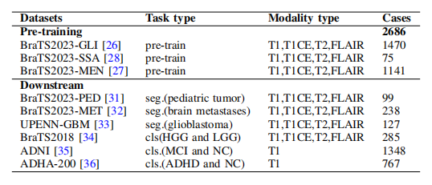

# DiscrepMamba 

This work introduces DiscrepMamba, a consecutive encoding by self-supervised learning with Mamba plus modality discrepancy Loss for brain MRI.

We achieve state-of-the-art performance on three open-source segmentation and three classification tasks. Feel free to use it to adapt to your own tasks!


## Abstract
Self-supervised learning (SSL) reduces annotation costs by generating pseudo-labels or supervisory signals and using them to train the model. It often uses a small-scale dataset in downstream tasks for fine-tuning in medical image processing, including brain magnetic resonance imaging (MRI), since SSL can significantly reduce the amount of medical image data required. However, for brain MRI, which is essential for diagnosing most neural system and soft tissue pathological changes, existing works have not fully analyzed the similarity and complementarity of the relationships between different modalities, but merely treated them as prior knowledge. To this end, DiscrepMamba is proposed, an SSL strategy with cascading encoders and modality structural discrepancy mediated by 3D reconstruction for brain MRI. Specifically, this study has investigated that the inter-modal differences primarily stem from structural heterogeneity, manifesting as divergent anatomical boundaries, distinct local gradient responses, and modality-specific structural characteristics. Their similarity, by contrast, arises from strong linear correlations in voxel intensity rather than from structural equivalence itself. Based on these findings, the cascading encoders are built upon the multi-task masked autoencoder with Vision Mamba. A Structure-Aware Frequency Consistency loss is further incorporated to enhance the model's representational capability through explicit structural constraints mediated by 3D reconstruction. Extensive experiments on six downstream brain MRI datasets across segmentation and classification demonstrate that DiscrepMamba generally outperforms the state-of-the-art works, with Dice score improvements of 4.51\% on average across three segmentation tasks and accuracy improvements of 3.24\% on average across three classification tasks.


## Datasets


All downstream datasets are open-source.
## Get Started

**Installation**
```bash
conda create -n discrepmamba python=3.10.13
conda activate discrepmamba
pip install -r requirements.txt
```

**Pre-train**
```bash 
bash train.sh
```
**Finetune**

We provide example code for fine-tuning on the BraTS-GLI dataset in the scripts folder, which you can modify to suit your own task.
```bash 
# finetune
bash fine_tuning_classify.sh
# evaluate
bash evaluate_classify.sh
```

## 🙏 Acknowledgement

A lot of code is modified from [MultiMAE](https://github.com/EPFL-VILAB/MultiMAE).


## 📝 Citation

If you find this repository useful, please consider citing this paper:
```
@unpublished{discrepmamba,
  title   = {Structure Beyond Intensity: Modality Discrepancy Preservation for Self-Supervised Brain MRI},
  author  = {Jia, Yumeng and Shen, Cong and Wang, Haifeng and Ma, Shiqiang and Chen, Shengyong and Tang, Jijun and Liao, Zhijun},
  note    = {submitted for publication},
  year    = {2026}
}
```
